# Smart PPE Compliance Firmware: State Machines (v1)

| Item | Value |
|---|---|
| Document | `docs/state_machines_v1.md` (document revision 1.1) |
| Status | DRAFT for owner review (S0) |
| Sources | `docs/SRS_v1.2.md`, `docs/protocol_spec_v1.1.md`, `docs/traceability_v1.2.md` |
| Findings | `docs/s0_findings_v1.md` (F-01 to F-20 are resolved in the sources above; section 4 of that file lists observations on SRS 1.2, marked V12-xx here) |
| Branch | `feature/s0-statemachines-testplan` |

### Revision history

| Revision | Change |
|---|---|
| 1.0 | First S0 draft against the S0 baseline (tag `s0-docs-done`). Undecided findings were marked pending. |
| 1.1 | Aligned with SRS 1.2 and protocol spec 1.1. All pending markers removed. Added: `KEY_FAULT` motor states and the `NO_KEY` boot path, `factory-reset` transitions (FR-46), `NODE_FAULT` transitions per cause (FR-17), wake loop guard with poll mode (FR-15), heartbeat during grace and grace expiry during a sequence (FR-06, FR-09), deep-sleep wake is not a boot (D-16), `drop_state` step and `scan_quiet_60s` (FR-22, FR-32, FR-21), `HUB_STATUS` coalescing (FR-52), fault codes (FR-30), `COMPLIANCE` rule (FR-28). Changed: FSR-only sensor fault (D-15), hub offline timeout from the provisioned `HEARTBEAT_S` (FR-41). |

## 0. How to read this document

- Every transition has an ID, a requirement (Req) and the test (TC) that verifies it. Req values are SRS IDs (FR-xx, NFR-xx, D-xx) or `spec x.y` where the protocol spec is the only source.
- Time values are defaults from the spec. `GRACE_S`, `SETTLE_MS`, `HEARTBEAT_S`, `OFFLINE_MARGIN_S` are provisioned parameters.
- Each machine is non-blocking: states are advanced by events and timers, never by `delay()` inside a state. This is a design rule because the node must keep polling its sensor during transmission (spec 7.5) and the hub must keep scanning during Wi-Fi activity (FR-53).
- V12-xx refers to an observation on SRS 1.2 listed in `docs/s0_findings_v1.md` section 4. The state machines use the stated interpretation until the owner decides.
- Machines are listed by prefix: **N-** node lifecycle, confirm and heartbeat, **R-** node sensor conversion, **T-** node transmit sequence, **B-** hub boot, **S-** scan supervisor, **P-** receive pipeline, **H-** hub node state, **C-** compliance, **M-** motor, **W-** Wi-Fi, **U-** uplink, **V-** serial commands, **X-** fault handling.

---

## 1. Node (ESP32-C3)

### 1.1 Context kept across deep sleep

Kept in RTC memory with a magic value and CRC (SRS D-16, protocol spec 1): `confirmed` (`NONE`, `NOT_WORN`, `WORN`) plus `sensor_fault`, `counter`, `ceiling`, `hb_deadline` (RTC time), `boot_pending`, `gpio_noop_wakes`, `poll_mode`. Trusted only when the reset reason is deep-sleep wake and the magic and CRC are valid. Any other start is a boot. Persistent in NVS: identity, key, parameters, `ceiling`.

Variables: `raw` (sensor conversion output, a pair `state`, `fault`), `candidate` (raw after settle), `confirmed`, `counter` (last used value, the next packet uses `counter + 1`), `ceiling` (highest value reserved in NVS).

Design rules:
- `ceiling` is clamped to `0xFFFFFFF0` when it is advanced, so the uint32 cannot wrap (V12-07).
- Serial commands are handled only while the node is awake: always when unprovisioned, for 60 s after entering `NODE_FAULT`, and during the boot grace (V12-02).

### 1.2 Lifecycle and power

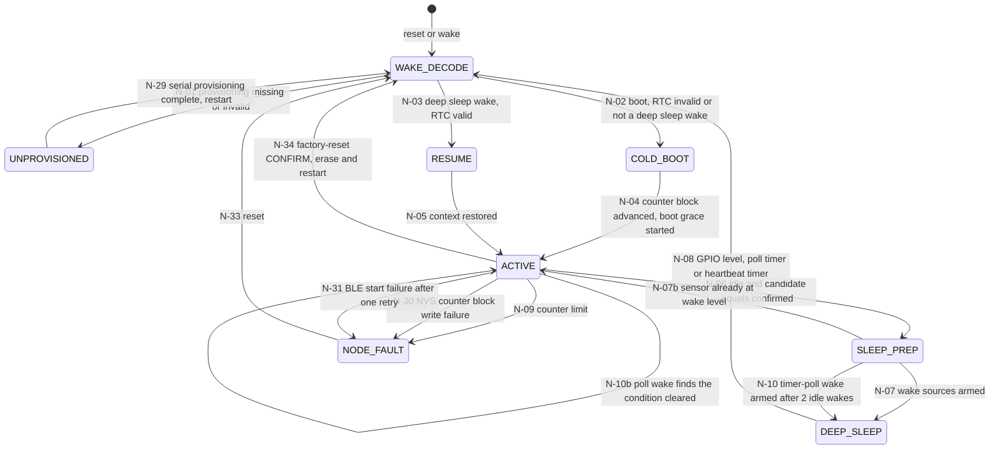

| ID | From | Event | Guard | Action | To | Timing | Req | TC |
|---|---|---|---|---|---|---|---|---|
| N-01 | WAKE_DECODE | reset or wake | `node_id` not in 1..5, `vest_id` not in 1..254, key absent or a parameter out of bounds | Radio never started. No packet. Serial provisioning enabled (node stays awake) | UNPROVISIONED | 0 packets in 10 min | FR-01, FR-45 | TC-01, TC-46 |
| N-29 | UNPROVISIONED | valid provisioning completes over serial | all fields in bounds | Write NVS (identity, key, parameters, counter baseline), software restart | WAKE_DECODE | | FR-40 | TC-40 |
| N-02 | WAKE_DECODE | start | reset reason is not deep-sleep wake (power-on, brown-out, watchdog, software or any other), or it is deep-sleep wake and the RTC context fails magic or CRC (D-16) | Load parameters from NVS | COLD_BOOT | | FR-01, FR-08, FR-11 | TC-01, TC-08, TC-11 |
| N-03 | WAKE_DECODE | start | reset reason is deep-sleep wake and the RTC context is valid | Restore `confirmed`, `counter`, `ceiling`, `hb_deadline`, `sensor_fault` from RTC. No NVS write, no `BOOT=1` | RESUME | no NVS write across 20 wakes | FR-11, FR-14 | TC-11, TC-14 |
| N-04 | COLD_BOOT | init done | NVS block write succeeds (else N-30) | `counter = ceiling` (NVS); `ceiling = min(ceiling + 64, 0xFFFFFFF0)`, write NVS before any transmit; `confirmed = NONE`; `boot_pending = 1`; `gpio_noop_wakes = 0`, `poll_mode = 0`; sample the sensor, `candidate = raw` (no settle); start the boot grace (N-20) | ACTIVE | NVS write before the first packet | FR-08, FR-11, FR-03 | TC-08, TC-11 |
| N-05 | RESUME | context restored | | Sample the sensor and start the filter. If the cause is the heartbeat timer and `now >= hb_deadline`, request a heartbeat (N-26) | ACTIVE | | FR-14, FR-15, FR-09 | TC-14, TC-15, TC-09 |
| N-06 | ACTIVE | every loop | filter idle AND confirm stable AND transmit idle AND no request pending | If the wake cause was GPIO and no candidate pair change occurred while awake: `gpio_noop_wakes += 1`, otherwise `gpio_noop_wakes = 0`. Prepare sleep | SLEEP_PREP | | FR-14, FR-15 | TC-14, TC-15 |
| N-07 | SLEEP_PREP | prepare done | sensor level not equal to wake level AND `poll_mode == 0` AND `gpio_noop_wakes < 2` | Wake level = opposite of `confirmed`. Timer wake = `max(0, hb_deadline - now)`. Save RTC context. Enter deep sleep | DEEP_SLEEP | | FR-15, FR-09, FR-14 | TC-15, TC-09 |
| N-07b | SLEEP_PREP | prepare done | sensor level equals wake level (a change arrived while preparing) | Abort sleep | ACTIVE | no missed change | FR-15 | TC-15 |
| N-08 | DEEP_SLEEP | GPIO at wake level, poll timer or heartbeat timer | | Chip restarts | WAKE_DECODE | | FR-15, FR-09 | TC-15, TC-09 |
| N-10 | SLEEP_PREP | prepare done | `gpio_noop_wakes >= 2` (an FSR count held in the dead band, or a helmet with only one contact closed), or `poll_mode == 1` | `poll_mode = 1`. Arm a timer-poll wake (period ≤ 1 s, set in S2) instead of the GPIO wake | DEEP_SLEEP | at most 2 consecutive GPIO wakes, then poll | FR-15, NFR-01 | TC-15, TC-70 |
| N-10b | ACTIVE | wake in `poll_mode` | the reading left the condition (a candidate change, or the sensor level no longer at the wake level) | `poll_mode = 0`, `gpio_noop_wakes = 0`. Then N-06 and N-07 re-arm the GPIO wake. A candidate change continues in N-21 | ACTIVE | a real change is detected within the NFR-01 budget | FR-15 | TC-15 |
| N-09 | ACTIVE | transmit build | `counter + 1 > 0xFFFFFFF0` | Stop transmitting, log the cause on serial. Recurs after a reset until re-provisioned | NODE_FAULT | 0 packets after the fault | FR-17 | TC-17 |
| N-30 | ACTIVE | boot block advance (N-04) or block extension (T-02) | NVS write of the counter block fails | Stop transmitting without a persisted block, log the cause | NODE_FAULT | 0 packets after the fault, no repeated counter | FR-17, FR-11, NFR-13 | TC-17, TC-11 |
| N-31 | ACTIVE | sequence start (T-03) | BLE stack fails to start twice (one retry) | Stop transmitting, log the cause | NODE_FAULT | 0 packets after the fault | FR-17 | TC-17 |
| N-33 | NODE_FAULT | any reset (power cycle, reset, watchdog) | | Cold boot (N-02). NVS and BLE faults clear. A counter-limit fault returns at N-09 | WAKE_DECODE | | FR-17 | TC-17 |
| N-34 | ACTIVE, NODE_FAULT | serial `factory-reset CONFIRM` | the word `CONFIRM` is present | Erase provisioning data and counters in NVS, invalidate the RTC context, restart. Next start is N-01 | WAKE_DECODE | node sends 0 packets in 10 min | FR-46 | TC-46 |

In `NODE_FAULT` the node does not transmit. After 60 s awake for serial the node enters deep sleep with no wake source until a reset (design rule, V12-06). The hub then sees the node as OFFLINE and starts the alert (H-07, H-10, M-01).

### 1.3 Sensor conversion (the `raw` value)

Evaluated every 50 ms while awake (AS-03).

| ID | Sensor | Rule | Req | TC |
|---|---|---|---|---|
| R-1 | Glove | Contact connected: `raw = (WORN, 0)`. Open: `(NOT_WORN, 0)` | FR-02 | TC-02 |
| R-2 | Boot (FSR) | Filtered count ≥ 1537: `WORN`. Count ≤ 88: `NOT_WORN`. In between: keep the previous raw state | FR-03, D-01 | TC-03 |
| R-3 | Helmet | `WORN` only if crown switch AND strap contact are both closed. Any other combination `NOT_WORN` | FR-04, D-02 | TC-04 |
| R-4 | Boot (FSR) only | Invalid reading (ADC read error or timeout, or a count outside the plausible range set in S2): `raw = (NOT_WORN, 1)` | FR-16, NFR-13 | TC-16 |
| R-5 | Boot (FSR) | First reading after a boot, count in the dead band 89 to 1536, no history: `NOT_WORN` | FR-03, NFR-13 | TC-03 |
| R-6 | Boot (FSR) only | Fault clears (valid reading again): `raw = (state from R-2, 0)` | FR-16 | TC-16 |
| R-7 | Glove, helmet | No fault detection in v1: `fault` is always 0. A disconnected contact reads open, which is NOT_WORN, and starts the alert (R-06) | D-15, FR-02, FR-04 | TC-02, TC-04 |

### 1.4 Settle filter

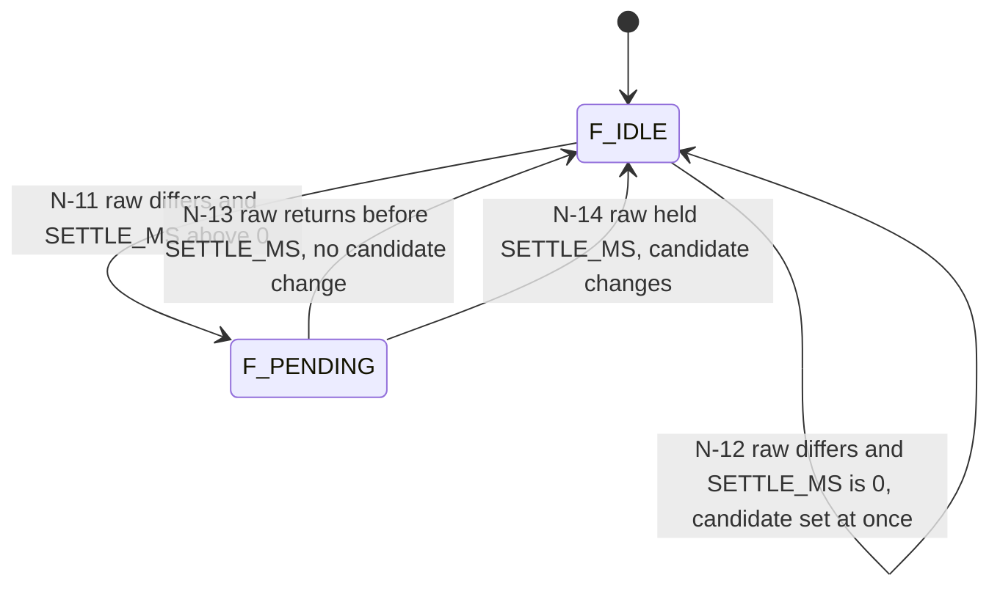

| ID | From | Event | Guard | Action | To | Timing | Req | TC |
|---|---|---|---|---|---|---|---|---|
| N-11 | F_IDLE | raw differs from candidate | `SETTLE_MS > 0` | Start settle timer | F_PENDING | | FR-05 | TC-05 |
| N-12 | F_IDLE | raw differs from candidate | `SETTLE_MS == 0` | `candidate = raw`, emit CANDIDATE_CHANGED | F_IDLE | within one poll, ≤ 50 ms | FR-05 | TC-05 |
| N-13 | F_PENDING | raw equals candidate again | settle timer running | Cancel timer. No candidate change | F_IDLE | 400 ms pulse at 500 ms gives no candidate | FR-05 | TC-05 |
| N-14 | F_PENDING | settle timer expired | raw still differs | `candidate = raw`, emit CANDIDATE_CHANGED | F_IDLE | 600 ms change at 500 ms gives a candidate | FR-05 | TC-05 |
| N-25 | any awake | 50 ms tick | | Poll sensor in every awake state, including transmit | | | FR-05, spec 7.5 | TC-05, TC-07 |

### 1.5 Confirm and grace

The compared value is the pair (`state`, `fault`) (FR-16).

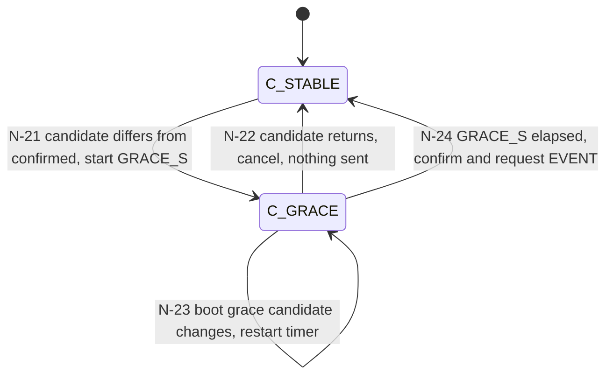

| ID | From | Event | Guard | Action | To | Timing | Req | TC |
|---|---|---|---|---|---|---|---|---|
| N-20 | (cold boot, N-04) | boot decision made | `confirmed == NONE` | Start `GRACE_S` timer. No packet before expiry | C_GRACE | no packet before 25 s | FR-08 | TC-08 |
| N-21 | C_STABLE | CANDIDATE_CHANGED | candidate pair differs from `confirmed` | Start `GRACE_S` timer (counted from the candidate change) | C_GRACE | | FR-06 | TC-06 |
| N-22 | C_GRACE | CANDIDATE_CHANGED | candidate pair equals `confirmed` | Cancel timer. No packet. Next change starts a full new timer | C_STABLE | revert at 10 s gives 0 packets; change, revert at 10 s, change at 12 s gives event at 37 ± 0.5 s | FR-06, D-03 | TC-06 |
| N-23 | C_GRACE | CANDIDATE_CHANGED | `confirmed == NONE` | Restart `GRACE_S` timer | C_GRACE | | FR-08, D-03 | TC-08 |
| N-24 | C_GRACE | timer expired (continuous difference) | | `confirmed = candidate pair`; request EVENT (`BOOT` bit = `boot_pending`); if a sequence is running the EVENT starts when it ends (FR-06 (e)) | C_STABLE | event at 25.0 ± 0.5 s; `GRACE_S=10` gives 10 ± 0.5 s | FR-06, FR-07, FR-08, FR-16 | TC-06, TC-07, TC-08, TC-16 |

### 1.6 Heartbeat timer

| ID | Event | Guard | Action | Timing | Req | TC |
|---|---|---|---|---|---|---|
| N-26 | `now >= hb_deadline` (also during C_GRACE: sent at its due time with the confirmed state, grace continues) | no heartbeat already requested | Request HEARTBEAT with the confirmed pair. If a sequence is running it starts after it ends | every interval ≤ 378 s, mean 360 ± 18 s | FR-09 | TC-09 |
| N-27 | A sequence starts (any type) | | `hb_deadline = t0 + HEARTBEAT_S` | next heartbeat 360 ± 18 s after an event | FR-09, spec 4 | TC-09 |
| N-28 | Sequence is about to start | EVENT and HEARTBEAT both requested | Run EVENT first, discard the heartbeat request (N-27 restarts the timer) | | FR-09, FR-07, spec 4 | TC-09 |

### 1.7 Transmit sequencer

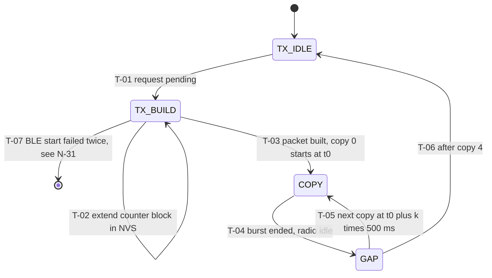

| ID | From | Event | Guard | Action | To | Timing | Req | TC |
|---|---|---|---|---|---|---|---|---|
| T-01 | TX_IDLE | request EVENT or HEARTBEAT | no sequence running (sequences never interleave) | EVENT has priority (N-28) | TX_BUILD | | FR-07, FR-09, FR-10 | TC-07, TC-09 |
| T-02 | TX_BUILD | `counter + 1 > ceiling` | | Write `min(ceiling + 64, 0xFFFFFFF0)` to NVS before using any value past the old ceiling. If the write fails: N-30 | TX_BUILD | at most 1 write per 64 packets | FR-11 | TC-11 |
| T-03 | TX_BUILD | ready | | `counter += 1`. Flags: `VER=01`, `TYPE`, `BOOT = boot_pending`, `LOW_BATT` (battery ≤ 20), `SENSOR_FAULT`. Battery from ADC (`0xFF` if the read fails). HMAC-SHA256 first 8 bytes over the first 9 payload bytes. `t0 = now`, `boot_pending = 0`, N-27 | COPY (k=0) | EVENT counter + 1; copies share counter | FR-10, FR-11, FR-12, FR-13, FR-16, FR-08 | TC-10, TC-11, TC-12, TC-13 |
| T-04 | COPY | burst ended (`ADV_BURST_MS`) | | Stop advertising | GAP | | FR-10 | TC-10 |
| T-05 | GAP | `now = t0 + (k+1) × 500 ms` | `k < 4` | Advertise the same 21 bytes (no recompute) | COPY | 500 ± 50 ms start to start | FR-10 | TC-10 |
| T-06 | GAP | copy 4 ended | | No 6th copy, no ack | TX_IDLE | none in following 10 s | FR-10 | TC-10 |
| T-07 | TX_BUILD | BLE stack start | start fails | Retry the start once. A second failure goes to N-31 (NODE_FAULT) | (NODE_FAULT) | | FR-17 | TC-17 |

Design rules for the node: grace, filter and sequencer run concurrently on a 50 ms scheduler tick plus a timer for copy spacing. Total awake time per event ≤ `GRACE_S` + 4 s (FR-14): settle + 25 s + about 0.4 s wake + 2.1 s sequence. The wake latency is subtracted from the grace deadline (AS-17).

### 1.8 Node timing summary

| Quantity | Value | Source |
|---|---|---|
| Candidate after change | ≤ 50 ms (SETTLE_MS = 0) | FR-05 |
| Event first copy after change | `SETTLE_MS` + 25.0 ± 0.5 s | FR-06 |
| Sequence length | ≤ 2.1 s (4 × 500 + 100) | spec 7.4 |
| Heartbeat interval | 360 ± 18 s, max 378 s | FR-09 |
| Awake per event | ≤ `GRACE_S` + 4 s | FR-14 |

---

## 2. Hub (ESP32-S3)

Tasks (design rule, FR-53): the BLE callback only copies the advertisement into a queue (depth ≥ 32, so a burst of 25 copies is not lost, NFR-03). A processing task runs P-03 to P-09, the node FSM, compliance and the motor decision. The motor task has its own timers. NVS persistence, Wi-Fi and uplink run in separate low-priority tasks and never block the processing task. The motor decision is made before any message is enqueued (FR-29 start ≤ 200 ms).

### 2.1 Boot sequence

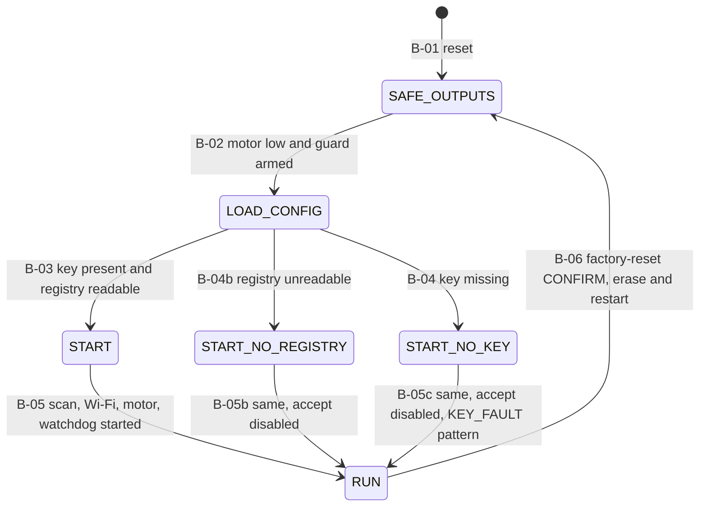

| ID | From | Event | Guard | Action | To | Timing | Req | TC |
|---|---|---|---|---|---|---|---|---|
| B-01 | (reset) | any reset | | First action: motor output low. The motor gate needs an external pull-down for the time before firmware runs (hardware assumption, confirm in S5) | SAFE_OUTPUTS | output low at boot | NFR-05 | TC-74 |
| B-02 | SAFE_OUTPUTS | done | | Arm the independent 400 ms motor guard timer (M-05). Open NVS | LOAD_CONFIG | | NFR-05 | TC-74 |
| B-03 | LOAD_CONFIG | config loaded | key present AND registry readable | Load `last_counter[1..5]`. All 5 nodes `UNKNOWN`, `last_seen = boot time`. Counters zeroed. `hub_seq = 0`. Accept enabled. `OFFLINE_TIMEOUT_S = 2 × HEARTBEAT_S + OFFLINE_MARGIN_S` from the provisioned values | START | | FR-25, FR-31, FR-24, FR-41 | TC-25, TC-31 |
| B-04 | LOAD_CONFIG | config loaded | key missing (includes an unprovisioned hub and a hub after factory reset) | `key_fault = true`. Accept disabled (all packets dropped). Slots for ids 1 to 5 exist as `UNKNOWN` with timers from boot. `HUB_FAULT` (`NO_KEY`) is logged on serial at once | START_NO_KEY | `NO_KEY` within 2 s of boot | FR-30, FR-46, NFR-13 | TC-30, TC-46 |
| B-04b | LOAD_CONFIG | config loaded | key present AND registry unreadable | Accept disabled (V12-03). Slots for ids 1 to 5 exist as `UNKNOWN` with timers from boot, so the nodes go OFFLINE (H-04) and the alert runs. `HUB_FAULT` (`REGISTRY`) queued | START_NO_REGISTRY | all nodes OFFLINE within 785 s of boot, alert active | FR-30, FR-25, FR-31 | TC-30 |
| B-05 | START | initialised | | Enqueue `HUB_BOOT` first (`hub_seq = 0`), then the fault stored by the previous run (X-07). Start the scan supervisor (S-01), Wi-Fi (W-02, or W-01 with no credentials), motor FSM (M-07), task watchdog, `HUB_STATUS` timer (U-08) | RUN | `HUB_BOOT` received | FR-31, FR-30, FR-54, FR-50 | TC-31, TC-30 |
| B-05b | START_NO_REGISTRY | initialised | | As B-05 with accept disabled, and the queued `REGISTRY` fault after `HUB_BOOT` | RUN | all nodes OFFLINE within 785 s | FR-30, FR-31 | TC-30 |
| B-05c | START_NO_KEY | initialised | | As B-05 with accept disabled. The queue holds `HUB_BOOT` then `HUB_FAULT` (`NO_KEY`). The scan supervisor runs. The motor starts the `KEY_FAULT` pattern (M-09). It ends only when a key is provisioned and the hub restarts (the restart happens automatically after the key command succeeds, V12-03) | RUN | `KEY_FAULT` pattern runs | FR-30, FR-46 | TC-30, TC-46 |
| B-06 | RUN | serial `factory-reset CONFIRM` | the word `CONFIRM` is present | Motor output low. Erase the key, Wi-Fi credentials, token, registry, `last_counter` and parameters. Restart. The next start takes B-04 | SAFE_OUTPUTS | `KEY_FAULT` pattern after reboot | FR-46 | TC-46 |

### 2.2 Scan supervisor (FR-20, FR-21)

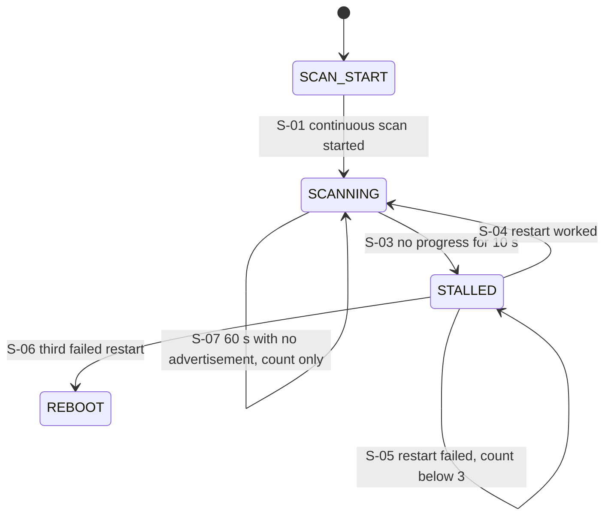

| ID | From | Event | Guard | Action | To | Timing | Req | TC |
|---|---|---|---|---|---|---|---|---|
| S-01 | SCAN_START | start | | Passive scan, window equals interval (parameters finalised in S3 with the Wi-Fi recheck), duplicate filtering OFF (copies are identical and must reach the pipeline) | SCANNING | no deliberate gaps; beacon every 10 s for 1 h received ≥ 99% | FR-20, FR-24 | TC-20 |
| S-02 | SCANNING | 1 s tick | scanner active per host stack and no sync loss | `progress = true`, clear stall timer | SCANNING | | FR-21 | TC-21 |
| S-03 | SCANNING | 1 s tick | scanner not active, or the host stack reports a sync loss, for 10 s (AS-08) | `restart_count = 1`, stop and restart scan | STALLED | scan resumes within 10 s | FR-21 | TC-21 |
| S-04 | STALLED | progress seen after restart | | `restart_count = 0` | SCANNING | packets received again | FR-21 | TC-21 |
| S-05 | STALLED | no progress 10 s after a restart | `restart_count < 3` | `restart_count += 1`, restart scan | STALLED | | FR-21 | TC-21 |
| S-06 | STALLED | no progress 10 s after a restart | `restart_count == 3` | Store fault `SCAN_STALL` in RTC memory (X-07), motor output low, restart the chip | REBOOT | 3 forced failures cause a reboot | FR-21, FR-30 | TC-21, TC-30 |
| S-07 | SCANNING | 60 s pass | no advertisement of any kind in those 60 s | `scan_quiet_60s += 1`, log only. No restart, no state change (receiving no advertisements is not a stall) | SCANNING | no restart or reboot in 10 min of no BLE traffic | FR-21, FR-32 | TC-21, TC-32 |

### 2.3 Receive pipeline (flow, one pass per advertisement)

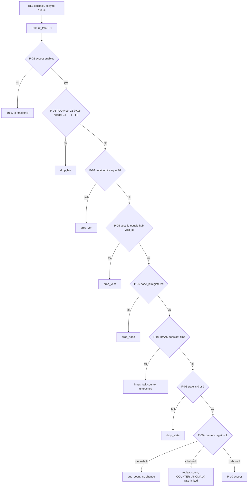

| ID | Step | Check or action | On failure or result | Req | TC |
|---|---|---|---|---|---|
| P-01 | Entry | Callback copies the data and a timestamp into the queue, `rx_total += 1` | Queue full: drop and count (design rule, not expected with depth 32) | FR-32, NFR-03 | TC-32, TC-72 |
| P-02 | Gate | `accept_enabled` (false in START_DEGRADED) | Drop | FR-30 | TC-30 |
| P-03 | Format | PDU is `ADV_NONCONN_IND`, AD data exactly 21 bytes, header `14 FF FF FF` | `drop_len` | FR-22 | TC-22 |
| P-04 | Version | `flags` bits 7 to 6 equal `01b`. Checked before the HMAC (spec 11) | `drop_ver` | FR-22 | TC-22 |
| P-05 | Vest | `vest_id` equals hub `vest_id` | `drop_vest` | FR-22 | TC-22 |
| P-06 | Node | `node_id` in the registry | `drop_node` | FR-22 | TC-22 |
| P-07 | HMAC | Recompute over payload bytes 0 to 8, compare all 8 bytes in constant time | `hmac_fail[n] += 1`. Counter and state untouched | FR-23, NFR-04 | TC-23, TC-73 |
| P-08 | State value | `state` is `0x00` or `0x01`. Checked after the HMAC and before the counter rule | `drop_state` | FR-22, FR-32 | TC-22, TC-32 |
| P-09 | Counter | `c > L` accept, `c == L` duplicate, `c < L` replay | See P-10 and the table below | FR-24, D-05, D-11 | TC-24 |
| P-10 | Accept | `last_counter[n] = c` in RAM; `gap_count += c - L - 1`; `accepted += 1`; update node entry (`state`, `battery`, `flags`, `last_seen`); run H-02, H-03, H-05, H-06, H-08, H-09, H-11 or H-12; evaluate compliance (C) and the motor (M); enqueue `PACKET` and `NODE_REBOOT` if `BOOT=1`; hand `(n, c)` to the persist task | | FR-24, FR-26, FR-28, FR-29, FR-50 | TC-24, TC-26, TC-50 |
| P-11 | Duplicate | `c == L`: drop silently, `dup_count += 1`, `last_seen` unchanged | | FR-24, D-05 | TC-24 |
| P-12 | Replay | `c < L`: drop, `replay_count += 1`, report `COUNTER_ANOMALY` at most once per node per 60 s, node state unchanged | | FR-24, D-11 | TC-24 |
| P-13 | Persist task | Write `last_counter[n]` to NVS after dispatch, from a non-blocking task. Several updates for one node may be coalesced to the newest | NVS write failure: X-05 | FR-24, D-13 | TC-24, TC-72 |

Counters (protocol spec 9.3): global `rx_total`, `drop_len`, `drop_ver`, `drop_vest`, `drop_node`, `drop_state`, `scan_quiet_60s` (log only, S-07); per node `hmac_fail`, `dup_count`, `replay_count`, `gap_count`, `accepted`.

### 2.4 Node state (one instance per registered node)

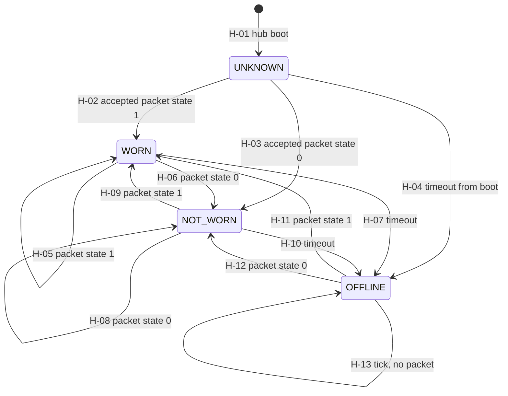

`UNKNOWN` is entered only at hub boot (FR-26, D-04). A node reset or reconnect never creates UNKNOWN: the previous state stays until the first accepted packet.

Timeout rule: on a 1 s tick, if `now - last_seen[n] > OFFLINE_TIMEOUT_S` (`2 × HEARTBEAT_S + OFFLINE_MARGIN_S`, default 780 s, using the hub's provisioned `HEARTBEAT_S`, FR-41), the node becomes OFFLINE.

| ID | From | Event | Guard | Action | To | Timing | Req | TC |
|---|---|---|---|---|---|---|---|---|
| H-01 | (boot) | B-03 | | `state = UNKNOWN`, `last_seen = boot` | UNKNOWN | no alert | FR-26, FR-31, D-04 | TC-26, TC-31 |
| H-02 | UNKNOWN | accepted packet | `state == 1` | WORN, `last_seen = now` | WORN | | FR-26 | TC-26 |
| H-03 | UNKNOWN | accepted packet | `state == 0` | NOT_WORN | NOT_WORN | alert starts ≤ 200 ms | FR-26, FR-29 | TC-26, TC-29 |
| H-04 | UNKNOWN | tick | timeout since boot | Enqueue `NODE_OFFLINE` | OFFLINE | 780 ± 5 s after boot | FR-26, FR-27, FR-31 | TC-27, TC-31 |
| H-05 | WORN | accepted packet | `state == 1` | Update `battery`, `flags`, `last_seen` | WORN | | FR-26 | TC-26 |
| H-06 | WORN | accepted packet | `state == 0` | NOT_WORN | NOT_WORN | alert starts ≤ 200 ms | FR-26, FR-29 | TC-26, TC-29 |
| H-07 | WORN | tick | timeout | Enqueue `NODE_OFFLINE` | OFFLINE | | FR-26, FR-27 | TC-26, TC-27 |
| H-08 | NOT_WORN | accepted packet | `state == 0` | Update fields | NOT_WORN | | FR-26 | TC-26 |
| H-09 | NOT_WORN | accepted packet | `state == 1` | WORN | WORN | alert stops ≤ 1 s if last offender | FR-26, FR-29 | TC-26, TC-29 |
| H-10 | NOT_WORN | tick | timeout | Enqueue `NODE_OFFLINE` | OFFLINE | | FR-26, FR-27 | TC-26, TC-27 |
| H-11 | OFFLINE | accepted packet | `state == 1` | WORN | WORN | | FR-26 | TC-26 |
| H-12 | OFFLINE | accepted packet | `state == 0` | NOT_WORN | NOT_WORN | | FR-26 | TC-26 |
| H-13 | OFFLINE | tick | no packet | None (no repeated `NODE_OFFLINE`) | OFFLINE | | FR-26, FR-27 | TC-27 |

One dropped heartbeat (all 5 copies) does not cause OFFLINE: the gap is at most 2 × 378 s = 756 s, below 780 s (FR-27). FR-41 recommends a margin of at least 40 s.

### 2.5 Compliance engine

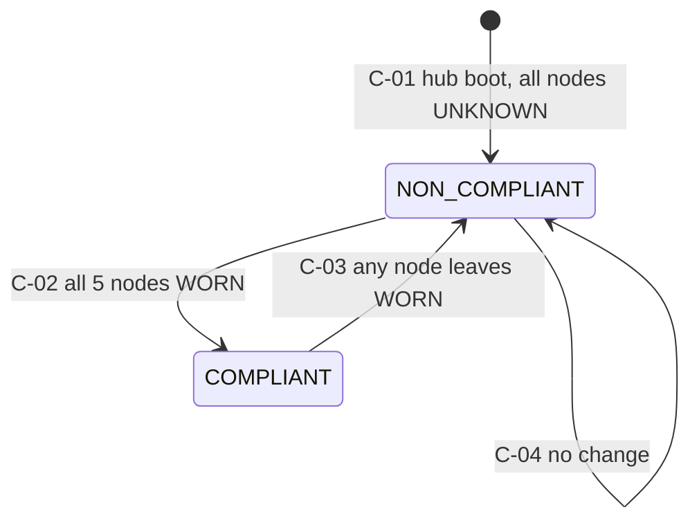

| ID | Event | Guard | Action | Req | TC |
|---|---|---|---|---|---|
| C-01 | Hub boot | | Initial state. It is not a transition, so no `COMPLIANCE` message is sent | FR-28, D-04, NFR-13 | TC-28 |
| C-02 | After any node transition | all 5 nodes `WORN` | Record and enqueue exactly one `COMPLIANCE` (`COMPLIANT`, empty `nodes_not_ok`) | FR-28, D-09 | TC-28, TC-62 |
| C-03 | After any node transition | at least one node NOT_WORN, OFFLINE (or UNKNOWN) | Record and enqueue exactly one `COMPLIANCE` (`NON_COMPLIANT`, `nodes_not_ok` lists the nodes not WORN) | FR-28, NFR-13 | TC-28 |
| C-04 | After any node transition | no change in the result | None | FR-28 | TC-28 |

`alert_active = any node is NOT_WORN or OFFLINE` (D-10). UNKNOWN is non-compliant but not part of `alert_active`.

### 2.6 Motor alert and key-fault pattern

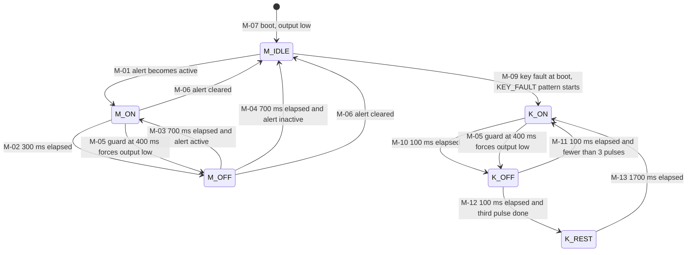

`alert_active = any node is NOT_WORN or OFFLINE` (D-10). `key_fault` is set at boot (B-04) and cleared only by a restart with a key (B-03). While `key_fault` is set the `K_*` states own the motor: M-01 and M-03 never fire, so the `KEY_FAULT` pattern has priority over the alert pattern (FR-30).

| ID | From | Event | Guard | Action | To | Timing | Req | TC |
|---|---|---|---|---|---|---|---|---|
| M-07 | (boot) | B-05 | | Output low, state idle | M_IDLE | low at boot | NFR-05, FR-31 | TC-74, TC-31 |
| M-01 | M_IDLE | `alert_active` rises | `key_fault` is false | Output high, start 300 ms timer, arm 400 ms guard | M_ON | ≤ 200 ms after the accepted packet or timeout | FR-29 | TC-29 |
| M-02 | M_ON | 300 ms timer | | Output low, cancel guard, start 700 ms timer | M_OFF | ON 300 ± 30 ms | FR-29 | TC-29 |
| M-03 | M_OFF | 700 ms timer | `alert_active` | Output high, start 300 ms timer, arm guard | M_ON | OFF 700 ± 30 ms | FR-29 | TC-29 |
| M-04 | M_OFF | 700 ms timer | not `alert_active` | None | M_IDLE | | FR-29 | TC-29 |
| M-05 | M_ON, K_ON | independent guard timer, 400 ms after the ON edge | | Output low by the guard, not by the pattern task. Log, report `HUB_FAULT` (`GUARD`). The pattern resumes at the next ON edge | M_OFF (K_OFF in the key pattern) | longest ON ≤ 400 ms, trip reported | NFR-05, FR-30 | TC-74, TC-30 |
| M-06 | M_ON, M_OFF | `alert_active` falls | | Output low at once, cancel timers | M_IDLE | stops ≤ 1 s after the last offender recovers | FR-29 | TC-29 |
| M-08 | any | task watchdog or scan reboot (X-01, X-02) | | Output low before the restart. After the restart B-01 applies | M_IDLE | | NFR-05, FR-30 | TC-74, TC-30 |
| M-09 | M_IDLE | boot with `key_fault` set (B-05c) | | Output high, `n = 1`, 100 ms timer, arm guard | K_ON | pattern starts at boot | FR-30 | TC-30, TC-46 |
| M-10 | K_ON | 100 ms timer | | Output low, cancel guard, 100 ms timer | K_OFF | ON 100 ± 20 ms | FR-30 | TC-30 |
| M-11 | K_OFF | 100 ms timer | `n < 3` | `n += 1`, output high, 100 ms timer, arm guard | K_ON | OFF 100 ± 20 ms (3 pulses) | FR-30 | TC-30 |
| M-12 | K_OFF | 100 ms timer | `n == 3` | Output stays low, 1700 ms timer | K_REST | then OFF 1700 ± 100 ms (V12-05) | FR-30 | TC-30 |
| M-13 | K_REST | 1700 ms timer | | `n = 1`, output high, 100 ms timer, arm guard | K_ON | period 2.3 s (protocol spec 8.3) | FR-30 | TC-30 |

The motor never depends on Wi-Fi or the dashboard (spec 8.3, FR-53).

### 2.7 Wi-Fi manager

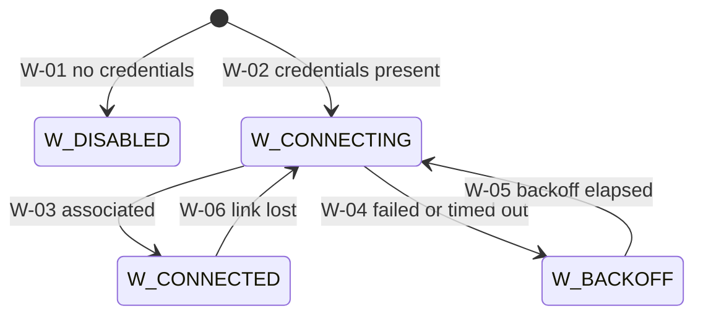

| ID | From | Event | Guard | Action | To | Req | TC |
|---|---|---|---|---|---|---|---|
| W-01 | start | B-05 | credentials missing | Uplink paused, queue still buffers. Scan and motor unaffected | W_DISABLED | FR-41, FR-53 | TC-53 |
| W-02 | start | B-05 | credentials present | Begin association in the Wi-Fi task | W_CONNECTING | FR-53 | TC-53 |
| W-03 | W_CONNECTING | associated | | Signal U-07 | W_CONNECTED | FR-50, NFR-07 | TC-50, TC-76 |
| W-04 | W_CONNECTING | failure or 10 s timeout | | Backoff 5 s doubling, cap 30 s (AS-16) | W_BACKOFF | FR-53 | TC-53 |
| W-05 | W_BACKOFF | timer | | Retry | W_CONNECTING | FR-53 | TC-53 |
| W-06 | W_CONNECTED | link lost | | Signal U-06 | W_CONNECTING | FR-52 | TC-52 |

### 2.8 Uplink queue and sender

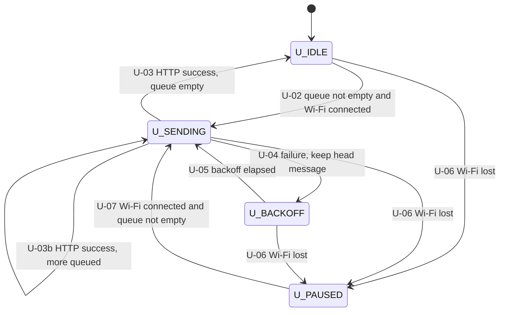

| ID | From | Event | Guard | Action | To | Timing | Req | TC |
|---|---|---|---|---|---|---|---|---|
| U-01 | any | message produced | queue length < 100 | Assign `hub_seq`, store enqueue time, push | (same) | | FR-50, FR-51, FR-52 | TC-50, TC-51 |
| U-01b | any | message produced | queue length = 100 | Drop the oldest, `dropped += 1`, push | (same) | oldest dropped, `dropped` counted | FR-52 | TC-52 |
| U-01c | any | `HUB_STATUS` produced | a `HUB_STATUS` is already in the buffer | Remove the older one, append the newer at the tail (order kept), `superseded += 1` (not `dropped`). At most one `HUB_STATUS` in the buffer (V12-08) | (same) | missing `hub_seq` = `dropped` + `superseded` | FR-52, FR-54 | TC-52, TC-54 |
| U-02 | U_IDLE | queue not empty | Wi-Fi connected | Take the head, set `age_ms = now - enqueue time`, POST one JSON object with the token header | U_SENDING | ≤ 5 s from accept to dashboard | FR-50, FR-51, NFR-07 | TC-50, TC-76 |
| U-03 | U_SENDING | HTTP 2xx | | Pop the head. Backoff reset to 1 s | U_IDLE | each message exactly once, in order | FR-50, FR-52 | TC-50, TC-52 |
| U-03b | U_SENDING | HTTP 2xx | more messages queued | Pop, send the next | U_SENDING | | FR-50, NFR-07 | TC-76 |
| U-04 | U_SENDING | non-2xx, error or 2 s timeout | | Keep the head. `backoff = min(30 s, 2 × backoff)`, starting at 1 s (AS-16) | U_BACKOFF | backoff 1 s up to 30 s | FR-52 | TC-52 |
| U-05 | U_BACKOFF | timer | Wi-Fi connected | Retry the head (the gateway de-duplicates on boot epoch and `hub_seq`, FR-50) | U_SENDING | | FR-52 | TC-52 |
| U-06 | U_IDLE, U_SENDING, U_BACKOFF | Wi-Fi lost (W-06) | | Keep the queue | U_PAUSED | | FR-52, FR-53 | TC-52, TC-53 |
| U-07 | U_PAUSED | Wi-Fi connected (W-03) | queue not empty | Resume with the head | U_SENDING | all buffered messages delivered in order | FR-52 | TC-52 |
| U-08 | (timer) | every 60 s, independent of Wi-Fi state | | Enqueue `HUB_STATUS` (`uptime_s`, `nodes`, `diag`, `buffer_fill`, `dropped`, `superseded`, protocol spec 10.1) | (same) | 60 ± 3 s | FR-54, FR-32, FR-52 | TC-54, TC-32 |

### 2.9 Serial command handler (hub and node)

| ID | Event | Guard | Action | Req | TC |
|---|---|---|---|---|---|
| V-01 | Provisioning command (hub: `vest_id`, key, Wi-Fi, gateway, token, `HEARTBEAT_S`, `OFFLINE_MARGIN_S`; node: ids, key, parameters, baseline) | all values in bounds | Write NVS, reply OK | FR-40, FR-41, FR-44 | TC-40, TC-41, TC-44 |
| V-02 | Provisioning command | a value out of bounds | Reply error, change nothing | FR-40, FR-41 | TC-40, TC-41 |
| V-03 | Hub `reset-counter <node_id\|all>` | id is registered or `all` | `last_counter = 0` (NVS write), enqueue `COUNTER_RESET`. The next valid packet with `c > 0` is accepted | FR-43 | TC-43 |
| V-04 | Any radio packet | | Never changes configuration. No configuration BLE service, no Wi-Fi configuration endpoint | FR-45 | TC-45 |
| V-05 | Key entry | | Key read from a file outside the repository by the host script, sent over serial, never echoed or logged | FR-42 | TC-42 |
| V-06 | Node or hub `factory-reset CONFIRM` | the word `CONFIRM` is present | Node: N-34. Hub: B-06. Erase provisioning data and counters, restart unprovisioned. After a node factory reset the operator runs `reset-counter` on the hub (V-03) | FR-46, FR-43 | TC-46, TC-43 |
| V-07 | Node or hub `factory-reset` without `CONFIRM` | | Reply with an error, change nothing | FR-46 | TC-46 |
| V-08 | Hub key command succeeds | `key_fault` is set | Store the key and restart the hub (automatic, V12-03). The next start takes B-03 and the `KEY_FAULT` pattern ends | FR-30, FR-46 | TC-30, TC-46 |

### 2.10 Fault handling

| ID | Fault | Detection | Action | Report (`HUB_FAULT` code) | Req | TC |
|---|---|---|---|---|---|---|
| X-01 | Scan stall | S-06 | Reboot after 3 failed restarts | `SCAN_STALL` stored, reported after boot (X-07) | FR-21, FR-30 | TC-21, TC-30 |
| X-02 | Task watchdog | Watchdog fires, reset reason | Reset, then B-01 (motor low) | `WDT_RESET` reported after boot (X-07) | FR-30, NFR-05 | TC-30, TC-74 |
| X-03 | NVS read failure | Registry unreadable at B-03: B-04b. Any other NVS read (not the key, not the registry): retry once, continue with compile-time defaults for non-critical parameters | Recover or degrade | `REGISTRY` for the registry, `NVS_READ` for the rest (V12-03) | FR-30 | TC-30 |
| X-04 | Missing key | B-03 | B-04, `KEY_FAULT` pattern, no packet accepted | `NO_KEY`, logged on serial within 2 s of boot | FR-30, FR-42, FR-46 | TC-30, TC-46 |
| X-05 | NVS write failure (persist task) | P-13 | Count it, keep running on RAM counters | `NVS_WRITE` | FR-30, FR-24 | TC-30 |
| X-06 | Motor guard trip | M-05 | Output low, pattern resumes at the next ON edge | `GUARD` | NFR-05, FR-30 | TC-74, TC-30 |
| X-07 | Fault before a reboot | X-01, X-02 | Store the fault code in RTC memory (the RAM queue is lost). B-05 enqueues it after `HUB_BOOT` | The stored code, when the uplink is available | FR-30 | TC-30 |

In every fault the motor is never continuously on, ON ≤ 400 ms (NFR-05).

---

## 3. Cross-machine rules

| Rule | Statement | Req |
|---|---|---|
| X-R1 | Accepted packet order on the hub: node FSM, compliance, motor decision, then enqueue messages and persist | FR-29, FR-24 |
| X-R2 | A sequence on the node is never interrupted or interleaved. A change during a sequence is handled by the confirm machine afterwards, with the grace timer counted from the candidate change. If it expires during a sequence the EVENT starts when the sequence ends. A heartbeat due during grace is sent at its due time with the confirmed state and grace continues | FR-06, FR-09, spec 7.5 |
| X-R3 | The node sleeps only when the filter is idle, the confirm machine is stable, the sequencer is idle and no request is pending | FR-14 |
| X-R4 | The hub accepts 5 identical copies as one packet (first accepted, 4 duplicates) | D-05, FR-24 |
| X-R5 | Wi-Fi, NVS and HTTP never run in the BLE callback, the processing task or the motor task | FR-53, NFR-03 |
| X-R6 | Test hooks (ADC injection, advertisement injection, stall and fault injection) exist only with `PPE_TEST_HOOKS`, never in the release build | NFR-09 |
| X-R7 | `KEY_FAULT` has priority over the alert pattern, and no packet is accepted while it runs | FR-30 |
| X-R8 | A new `HUB_STATUS` removes the older one from the uplink buffer and is appended at the tail, so delivery stays in `hub_seq` order. The removed one counts as superseded | FR-52 |
| X-R9 | A deep-sleep wake is not a boot: no counter advance, no NVS write, no `BOOT=1` | FR-11, D-16 |

### 3.1 Alert latency budget (NFR-01, defaults, `SETTLE_MS = 0`)

| Step | Time |
|---|---|
| Raw change to candidate | ≤ 0.05 s |
| Grace | 25.0 s |
| Wake latency | compensated in the grace deadline (AS-17) |
| Build and first copy start | ≤ 0.1 s |
| Hub filter, verify, dispatch | ≤ 0.01 s (NFR-03) |
| Motor start | ≤ 0.2 s (FR-29) |
| **Total, first copy received** | **≈ 25.4 s** |
| Each lost copy adds | 0.5 s |

Limit 28 s. Slack 2.6 s covers four lost copies (27.4 s). With the timer-poll wake of N-10 add up to 1 s, so the limit holds only with up to three lost copies. S9 measures it (TC-70).

## 4. Check against SRS 1.2 and protocol spec 1.1

| Area | Result |
|---|---|
| Node confirm, grace, boot (FR-05 to FR-08, spec 8.1) | Matches, including grace expiry during a sequence (FR-06 (e)) and the boot grace restart (FR-08 (b)) |
| Counter and NVS block (FR-11, spec 6.1) | Matches. A deep-sleep wake is not a boot (N-03, X-R9). `ceiling` clamp added (V12-07) |
| Retransmission (FR-10, spec 7) | Matches (5 copies, 500 ± 50 ms, bounded) |
| Heartbeat (FR-09, spec 4) | Matches, including a heartbeat due during grace (N-26) |
| Wake (FR-15, spec 8.1.6 and 8.1.7) | Matches with the loop guard and poll mode (N-10, N-10b) |
| Sensor fault (FR-16) | Matches for FSR boots only (R-4, R-6). Gloves and helmet have none (R-7). Timing reference for a fault arising in sleep: V12-01 |
| Node faults (FR-17, spec 6.1.5) | Matches, one transition per cause (N-09, N-30, N-31). Behavior after logging chosen (V12-06) |
| Receive filter order (FR-22, spec 2) | Matches, `drop_state` after the HMAC (P-08) |
| HMAC and counter rule (FR-23, FR-24, spec 5, 6.2) | Matches |
| Node state (FR-26, spec 8.2) | Matches. UNKNOWN only at hub boot (D-04) |
| Offline (FR-27, FR-31) | Matches. Offline window wording differs between FR-27 and FR-31 (V12-04) |
| Compliance (FR-28) | Matches. One `COMPLIANCE` per vest change, none at boot |
| Motor (FR-29, NFR-05, spec 8.3) | Matches, including the guard report. `KEY_FAULT` gap after the third pulse: V12-05 |
| Scan watchdog (FR-21, spec 9.3) | Matches. `scan_quiet_60s` is log only (S-07) |
| Hub faults (FR-30) | Matches. Code mapping and acceptance in the registry fault: V12-03 |
| Uplink queue (FR-50 to FR-54, spec 10) | Matches, including coalescing (U-01c) and boot ordering (B-05). Counts reported at generation time: V12-08 |
| Provisioning (FR-40 to FR-46) | Matches. Serial reach of a sleeping node: V12-02 |

No conflict was found in the packet layout, HMAC input, counter rule, retransmission rule or filter order. The V12 observations are in `docs/s0_findings_v1.md` section 4. They are not fixed here.

## 5. Coverage: requirement to transitions (informational)

Every transition above cites at least one requirement and one test (checked by script against SRS 1.2 and traceability 1.2: 0 transitions without a valid requirement ID or TC). The reverse view shows where each requirement appears. FR-60 to FR-63 are dashboard content with no firmware state machine (dashboard design is out of scope). NFR-02, 06, 08 to 12 are verified by test or inspection only. FR-02 to FR-04 are covered by the conversion rules R-1 to R-7.

| Req | Transitions and rules |
|---|---|
| FR-01 | N-01,N-02 |
| FR-02 | R-1,R-7 |
| FR-03 | N-04,R-2,R-5 |
| FR-04 | R-3,R-7 |
| FR-05 | N-11,N-12,N-13,N-14,N-25 |
| FR-06 | N-21,N-22,N-24 |
| FR-07 | N-24,N-28,T-01 |
| FR-08 | N-02,N-04,N-20,N-23,N-24,T-03 |
| FR-09 | N-05,N-07,N-08,N-26,N-27,N-28,T-01 |
| FR-10 | T-01,T-03,T-04,T-05,T-06 |
| FR-11 | N-02,N-03,N-04,N-30,T-02,T-03 |
| FR-12 | T-03 |
| FR-13 | T-03 |
| FR-14 | N-03,N-05,N-06,N-07 |
| FR-15 | N-05,N-06,N-07,N-07b,N-08,N-10,N-10b |
| FR-16 | R-4,R-6,N-24,T-03 |
| FR-17 | N-09,N-30,N-31,N-33,T-07 |
| FR-20 | S-01 |
| FR-21 | S-02,S-03,S-04,S-05,S-06,S-07,X-01 |
| FR-22 | P-03,P-04,P-05,P-06,P-08 |
| FR-23 | P-07 |
| FR-24 | B-03,S-01,P-09,P-10,P-11,P-12,P-13,X-05 |
| FR-25 | B-03,B-04b |
| FR-26 | P-10,H-01,H-02,H-03,H-04,H-05,H-06,H-07,H-08,H-09,H-10,H-11,H-12,H-13 |
| FR-27 | H-04,H-07,H-10,H-13 |
| FR-28 | P-10,C-01,C-02,C-03,C-04 |
| FR-29 | P-10,H-03,H-06,H-09,M-01,M-02,M-03,M-04,M-06 |
| FR-30 | B-04,B-04b,B-05,B-05b,B-05c,S-06,P-02,M-05,M-08,M-09,M-10,M-11,M-12,M-13,V-08,X-01,X-02,X-03,X-04,X-05,X-06,X-07 |
| FR-31 | B-03,B-04b,B-05,B-05b,H-01,H-04,M-07 |
| FR-32 | S-07,P-01,P-08,U-08 |
| FR-40 | N-29,V-01,V-02 |
| FR-41 | B-03,W-01,V-01,V-02 |
| FR-42 | V-05,X-04 |
| FR-43 | V-03,V-06 |
| FR-44 | V-01 |
| FR-45 | N-01,V-04 |
| FR-46 | N-34,B-04,B-05c,B-06,V-06,V-07,V-08,X-04 |
| FR-50 | B-05,P-10,W-03,U-01,U-02,U-03,U-03b,U-05 |
| FR-51 | U-01,U-02 |
| FR-52 | W-06,U-01,U-01b,U-01c,U-03,U-04,U-05,U-06,U-07,U-08 |
| FR-53 | W-01,W-02,W-04,W-05,U-06 |
| FR-54 | B-05,U-01c,U-08 |
| FR-60 | none (test or inspection only) |
| FR-61 | none (test or inspection only) |
| FR-62 | none (test or inspection only) |
| FR-63 | none (test or inspection only) |
| NFR-01 | N-10,N-10b |
| NFR-02 | none (test or inspection only) |
| NFR-03 | P-01 |
| NFR-04 | P-07 |
| NFR-05 | B-01,B-02,M-07,M-05,M-08,X-02,X-06 |
| NFR-06 | none (test or inspection only) |
| NFR-07 | W-03,U-02,U-03b |
| NFR-08 | none (test or inspection only) |
| NFR-09 | none (test or inspection only) |
| NFR-10 | none (test or inspection only) |
| NFR-11 | none (test or inspection only) |
| NFR-12 | none (test or inspection only) |
| NFR-13 | N-30,R-4,R-5,B-04,C-01,C-03 |
